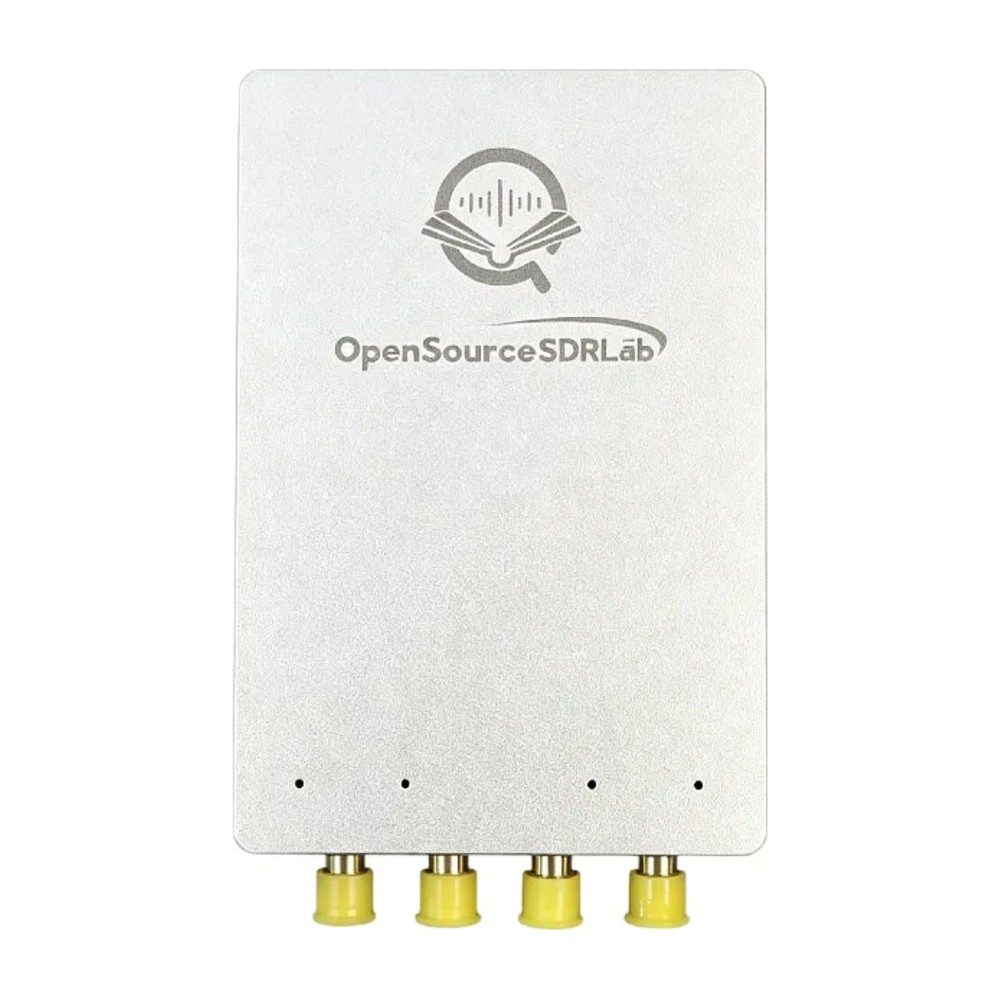
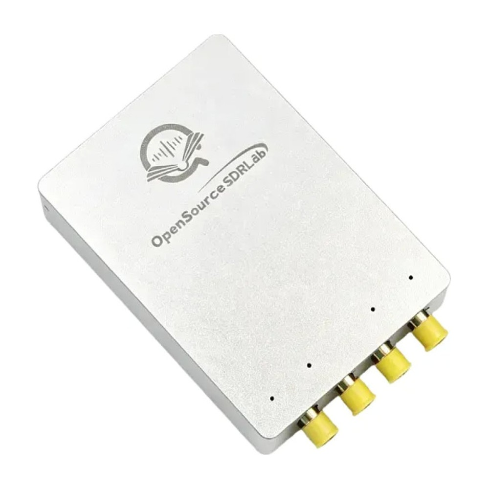

# USRP-B210-Artix-7-AD9361

Schematic, FPGA source projects and FPGA images for the **OpenSourceSDRLab USRP B210 (Artix-7)**, a USRP B210-compatible software-defined radio that pairs the Analog Devices AD9361 RF transceiver with a Xilinx Artix-7 XC7A75T or XC7A200T FPGA.

  
  

## Product link

<https://opensourcesdrlab.com/products/opensourcesdrlab-usrp-b210-ad9361-and-xilinx-xc7a75t-or-xc7a200t>

## About the board

- RF transceiver: Analog Devices **AD9361**, 2 TX + 2 RX, full duplex and half duplex, 70 MHz to 6 GHz, up to 56 MHz real-time bandwidth
- RF ports: TRX1, RX1, RX2, TRX2 on SMA connectors
- FPGA: Xilinx **Artix-7 XC7A75T** or **XC7A200T** (two versions) in place of the Spartan-6 of the original B210; FPGA projects for **Vivado 2024.1**
- Host interface: **USB 3.0 Type-C** through a Cypress/Infineon CYUSB3014 (FX3) controller
- Timing: external **10 MHz** and **PPS** inputs on MMCX, for example from an external GPSDO; the GPSDO slot of the original B210 is removed
- Expansion: MX1.25 connector with spare FPGA GPIO
- Size: 70 × 97 mm
- Software: works with the Ettus Research **UHD** driver and UHD-based applications (GNU Radio, SDRangel, Gqrx and others). The board needs the FPGA image for its FPGA version, `usrp_b210_fpga.bin`, from this repository's Releases; the stock Ettus image does not run on it.

## Quick start

1. Install UHD from Ettus Research (Windows installer, or the `uhd-host` package on Ubuntu) and download its standard images.
2. Replace `usrp_b210_fpga.bin` in the UHD images folder with the file for your FPGA version (XC7A75T or XC7A200T) from the [Releases](../../releases) page.
3. Connect the board to a USB 3.0 port and run `uhd_find_devices` and `uhd_usrp_probe`.

The full steps are in the **[Quick Start Guide](docs/Quick-Start-Guide.md)** ([PDF](docs/Quick-Start-Guide.pdf)).

## User manual

- User manual (Windows and Ubuntu setup, SDRangel, URH, GNU Radio, SDR# and Gqrx): <https://blog.opensourcesdrlab.com/archives/artix-7-usrp-b210-user-manual>
- Selecting the antenna ports in Gqrx and GNU Radio: <https://blog.opensourcesdrlab.com/archives/usrp-b210-artix-7-antenna-ports-gqrx-gnu-radio>

## Repository layout

| Path | Contents |
|---|---|
| `hardware/USRP-B210-Artix-7-AD9361_Schematic.pdf` | Board schematic (PDF) |
| `fpga/XC7A75T/` | Vivado 2024.1 project of the FPGA image for the XC7A75T version, based on the Ettus Research USRP B200/B210 FPGA design |
| `fpga/XC7A200T/` | The same for the XC7A200T version |
| `docs/` | Quick Start Guide (Markdown and PDF) |
| `images/` | Product photos |

## Downloads (Releases)

Prebuilt files are attached to the [Releases](../../releases) page instead of being stored in the repository:

| File | Contents |
|---|---|
| `USRP-B210-Artix-7-AD9361_XC7A75T_FPGA-image_Vivado2024.1.zip` | `usrp_b210_fpga.bin` for the XC7A75T version (built 2026-06-26 from `fpga/XC7A75T/`) |
| `USRP-B210-Artix-7-AD9361_XC7A200T_FPGA-image_Vivado2024.1.zip` | `usrp_b210_fpga.bin` for the XC7A200T version (built 2026-06-26 from `fpga/XC7A200T/`) |
| `SHA256SUMS.txt` | SHA-256 checksums of the files above |

Check a download with `shasum -a 256 -c SHA256SUMS.txt` (macOS / Linux) or `certutil -hashfile <file> SHA256` (Windows).

## Licence

Files created by OpenSourceSDRLab are released under the [Apache License 2.0](LICENSE). The FPGA designs in `fpga/` are derived from the Ettus Research USRP FPGA code in UHD and remain under the GNU LGPL v3 ([fpga/LICENSE.md](fpga/LICENSE.md)); Xilinx IP configuration files remain under Xilinx/AMD terms. See [NOTICE.md](NOTICE.md) for the file-by-file list.

## Support

- Email: support@opensourcesdrlab.com
- Forum: <https://forum.opensourcesdrlab.com>
- Discord: <https://discord.gg/nnxY6DkmvT>
- Blog and user manuals: <https://blog.opensourcesdrlab.com>

---
© 2026 OpenSourceSDRLab. All rights reserved. · <a href="https://www.opensourcesdrlab.com">www.opensourcesdrlab.com</a>
